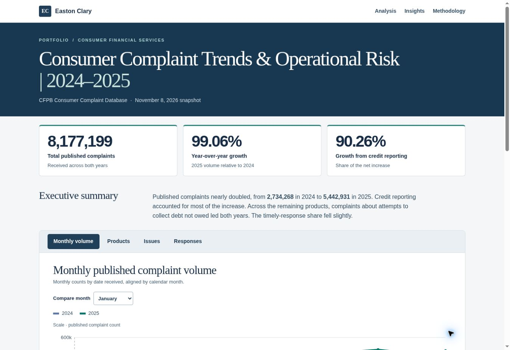

# Consumer Complaint Trends & Operational Risk | 2024–2025

An interactive, self-contained portfolio dashboard analyzing **8,177,199 published consumer complaints** received by the U.S. Consumer Financial Protection Bureau (CFPB) during 2024 and 2025. The analysis focuses on complaint-volume trends, product concentration, consumer-reported issues, and company response timeliness.

**[View the interactive dashboard](https://eastonclary.github.io/consumer-complaint-dashboard/)** (available after GitHub Pages is enabled)

## Executive summary

- **8,177,199** published complaints from January 1, 2024, through December 31, 2025.
- The published-complaint count increased from **2,734,268 in 2024** to **5,442,931 in 2025** (**99.06%**).
- The credit-reporting product accounted for **2,444,705** of the **2,708,663** additional published complaints (**90.26%** of the net increase).
- Outside the credit-reporting product, the issue **“Attempts to collect debt not owed”** was the most frequent issue in both years.
- The share of published complaints marked as timely responses fell slightly, from **99.72%** to **99.55%**.

These figures describe **published complaints**, not verified violations, unique complainants, customer-level complaint rates, or prevalence of harm. Reporting practices and publication criteria can affect comparisons.

## Dashboard features

The dashboard includes four interactive analyses:

1. **Monthly volume:** 2024 versus 2025 complaint volumes by receipt month.
2. **Products:** Complaint totals by CFPB product category and contributions to the net increase.
3. **Issues:** Leading issue categories, with an alternate view excluding the exact credit-reporting product category.
4. **Responses:** Company response-stage distributions and timely-response metrics, with explicit denominators.

Each analysis provides the underlying calculations, a finding, and a limitation. The dashboard runs offline as a standalone HTML page without external JavaScript dependencies.

## Files

| File | Purpose |
| --- | --- |
| `index.html` | Interactive dashboard; GitHub Pages entry point |
| `CFPB_chart_calculations.csv` | Aggregated chart calculations, including counts and denominators |
| `CFPB_cleaning_log.md` | Reproducible cleaning decisions, reconciliations, and data-quality audit |
| `prepare_cfpb.py` | Python script to reproduce the analysis-ready dataset from the archived original |
| `dashboard-preview.jpg` | Dashboard image for portfolio preview |

The approximately 8.2 million-row working dataset and the full original CFPB archive are intentionally **not** included in this repository. The documented preparation script works from the exact source snapshot whose SHA-256 checksum is recorded in the cleaning log.

## Methodology

- **Source:** [CFPB Consumer Complaint Database](https://www.consumerfinance.gov/data-research/consumer-complaints/), snapshot dated November 8, 2026.
- **Population:** Published records with `Date received` from January 1, 2024, through December 31, 2025 (inclusive).
- **Unit of analysis:** One unique Complaint ID; no duplicate IDs in the selected sample.
- **Transformations:** Retain all 15 source fields, trim boundary whitespace, preserve source classifications and missing values, and add explicit data-quality flags.
- **Data quality:** 553,624 records contain partial or fully masked ZIPs; these were retained. No reversed sent/receipt dates or malformed ZIPs appeared within the selected period.
- **Outcome analysis:** In-progress, untimely-response, and missing response statuses are not silently counted as completed outcomes. Percentages display their actual denominators.

See [`CFPB_cleaning_log.md`](CFPB_cleaning_log.md) for detailed reconciliation and reproducibility notes.

## Interpretation and limitations

The database contains consumer complaints selected for publication; it does not independently validate each allegation. Raw counts do not adjust for company size, customers served, submission behavior, product utilization, or publication policy. Some submissions may concern multiple credit-reporting agencies. Historical CFPB product/issue labels and publication policies may change. ZIP masking limits geographic granularity, but those complaints remain in overall totals.

For background, see the [CFPB database documentation](https://www.consumerfinance.gov/data-research/consumer-complaints/), [CFPB field reference](https://cfpb.github.io/api/ccdb/fields.html), and [2025 Consumer Response Annual Report](https://files.consumerfinance.gov/f/documents/cfpb_2025-cr-annual-report_2026-03.pdf).

## Author

**Easton Clary** · Portfolio project demonstrating data quality assessment, reproducible analysis, interactive data presentation, and operational-risk interpretation.
